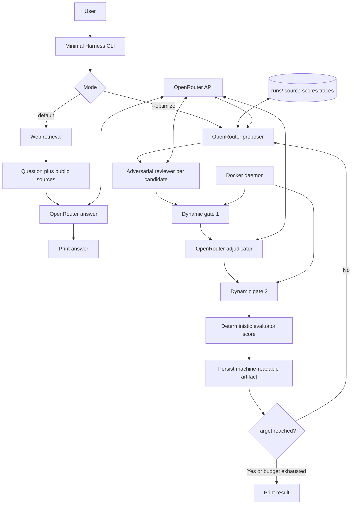

# Minimal Harness

A modified Meta-Harness where agents propose, test, challenge, and adjudicate coding harnesses for iterative improvement.

Minimal Harness is a Python control plane inspired by **Meta-Harness: End-to-End Optimization of Model Harnesses** ([arXiv:2603.28052v1](https://arxiv.org/html/2603.28052v1)). It combines a direct research-answer mode with a modified candidate-search loop.

This repository is an independent modification. It is not the paper authors' artifact and does not reproduce their benchmark numbers.

## Installation

Requires Python 3.11 or newer. There is no `requirements.txt`; dependencies
live in `pyproject.toml` as optional extras.

Create and activate a virtual environment:

```bash
cd minimal-harness
python3 -m venv .venv
source .venv/bin/activate
python -m pip install --upgrade pip
```

Then install the extras for what you want to run:

| Goal | Install command | Adds |
| --- | --- | --- |
| CLI, answer mode, and optimizer | `pip install -e .` | No runtime dependencies (standard library only) |
| Web search and browser tools | `pip install -e ".[browser]"` then `playwright install chromium` | Playwright and headless Chromium |
| Desktop app (classic, HAL, cyber) | `pip install -e ".[voice,browser]"` then `playwright install chromium` | PySide6, voice input, TTS, and browser tools |
| Development and tests | `pip install -e ".[dev]" flake8 pycodestyle` | Black, Playwright, and py2app on macOS |

Activate the virtual environment in every new terminal before running any
command:

```bash
source .venv/bin/activate
```

Copy the example configuration and edit it:

```bash
cp .env.example .env
```

Then run the harness:

```bash
python -m meta_harness.cli "Explain this repository's architecture"   # answer mode
harness-gui                                                           # desktop app
```

The desktop mode comes from `HARNESS_UI_MODE` in `.env`: `classic`, `hal`, or
`cyber`. You can override it per launch, for example `HARNESS_UI_MODE=hal
harness-gui`. `harness-voice` is an alias for `harness-gui`.

## What The Paper Says

The paper describes a system that “repeatedly proposes, evaluates, and logs new harnesses.” Its central engineering decision is to let an agent inspect a filesystem containing prior candidate source code, evaluation scores, and raw execution traces.

The paper also says the proposer is a coding agent that can invoke developer tools and modify code, and that the proposer should selectively retrieve history rather than receive a lossy summary. Its practical tips emphasize a good skill, a difficult search set, queryable machine-readable logs, lightweight validation before expensive evaluations, and an evaluator outside the proposer.

The paper's search loop is approximately:

```text
initial valid harnesses
  -> evaluate candidates
  -> store source, scores, and traces
  -> proposer inspects filesystem history
  -> proposer writes a new harness
  -> external evaluator scores it
  -> log artifacts
  -> repeat for fixed N iterations
  -> evaluate Pareto frontier on held-out data
```

## What We Modified

Minimal Harness keeps the paper's proposer, external-evaluation, artifact-history, and repeated-search ideas, then adds explicit policy stages requested for this project:

```text
proposer candidate
  -> adversarial reviewer for that candidate
  -> dynamic test gate 1
  -> adjudicator
  -> dynamic test gate 2
  -> verified winner or another cycle
```

The paper does **not** specify adversarial reviewers, Docker gates, an adjudicator, or a universal 100% stopping rule. Those are our extensions.

| Concern | Paper | Minimal Harness |
| --- | --- | --- |
| Proposal | Coding-agent proposer | OpenRouter proposer |
| History | Full filesystem access | `runs/` JSON artifacts |
| Evaluation | External evaluator | Docker gate abstraction |
| Review | Not a defined stage | One adversarial review per candidate |
| Adjudication | Population/Pareto frontier | Adjudicator selects a survivor |
| Stopping | Fixed iteration budget | Target score or iteration budget |
| Final evaluation | Held-out test set | Domain evaluator still required |

## Architecture



## Two Modes

### Answer Mode

The default command runs the bounded agent tool loop and prints a direct answer. The model can request `web_search` when public sources are useful.

```bash
python3 -m meta_harness.cli "Who is Kevin Thomas of Reverse Engineering mytechnotalent?"
```

Expected progress output:

```text
Searching web...
Asking OpenRouter...
<answer>
```

Useful examples:

```bash
python3 -m meta_harness.cli "What does the Meta-Harness paper contribute?"
python3 -m meta_harness.cli "How does Docker help evaluate coding agents?"
python3 -m meta_harness.cli --no-web "Explain this repository's architecture"
```

The default mode also supports the file, terminal, web, browser, and evaluator tools when the model requests them.

### Interactive Tool Loop

The default runtime now includes a bounded Pi-like tool loop. OpenRouter can request these tools and receive their results before producing its final response:

- `read`: read a file inside the workspace.
- `write`: create or replace a file inside the workspace.
- `edit`: replace exactly one matching text fragment.
- `bash`: run a shell command from the workspace with a timeout.
- `web_search`: retrieve public search results and GitHub profile fallback data.
- `browser_open`: inspect a page title, URL, and visible text with Playwright.
- `browser_screenshot`: capture a full-page PNG with Playwright.
- `ask`: present a question with clickable options and a "type your own answer" entry.
- `suggest`: record short optional next-step buttons shown after an answer.

File paths are confined to the workspace root. This loop supports real website generation, local commands, web retrieval, browser inspection, screenshots, JSONL sessions, steering, follow-ups, context compaction, and a full-screen curses TUI.

The agent is instructed to **ask rather than assume**: when a request is
missing information, it asks one question at a time through the `ask` tool
instead of guessing. Interactive frontends render 2–5 options plus a
"type your own answer" choice; `--interactive` uses a numbered prompt.

Answers are written as separate paragraphs with a blank line between
sections, and warnings come last. Optional next steps the agent did not have
to mention are delivered through the `suggest` tool and shown under a
"Suggestions:" heading as short, mouse-clickable entries in the TUI (numbered
in `--interactive`); clicking one runs it as your next message.

### Answer review

Final answers can pass through a second adversarial model call before they
are returned or spoken. The reviewer receives the question, the draft answer,
and the tool evidence, and removes or revises unsupported claims.
`HARNESS_ANSWER_REVIEW` accepts `1` (always review), `0` (never), or `auto`
(review only tool-backed answers and answers of 400+ characters).

Set `HARNESS_ADVERSARIAL_DRAFTS=N` (default `0`) to generate N independent
drafts, adjudicate them with `adversarial.md`, and then review the winner. This
is test-time adversarial compute: more model calls for harder tasks, bounded
by the draft count.

### Token efficiency

Token use is controlled without switching models:

- `HARNESS_ANSWER_REVIEW=auto` skips the review call for short, tool-free
  answers.
- `HARNESS_CODING_STANDARDS=auto` loads the large coding-standards prompt only
  for likely coding tasks. Use `1` to always load it or `0` to never load it.
- `HARNESS_CONTEXT_CHARS` (default `60000`) compacts the conversation when it
  grows too large; `HARNESS_CONTEXT_KEEP` (default `16`) sets how many recent
  messages survive.
- `HARNESS_TOOL_OUTPUT_LIMIT` (default `12000`) caps how many characters one
  tool result can add to the context.
- `--usage` prints `calls`, `prompt_tokens`, and `completion_tokens` after an
  answer so you can measure a change.

```bash
python3 -m meta_harness.cli --usage "Summarize this repository"
```

The live tool loop has been tested with OpenRouter prompts that caused the agent to create files, run bash verification, invoke `web_search`, and create a website.

Run an interactive session with a persistent JSONL transcript:

```bash
python3 -m meta_harness.cli --interactive --session runs/session.jsonl "Inspect this workspace"
```

Enter prompts at `you>`. Type `/quit` to exit. The transcript stores user, assistant, and tool-result messages.

Launch the full-screen terminal interface:

```bash
python3 -m meta_harness.cli --tui --session runs/tui-session.jsonl "Inspect this workspace"
```

Type prompts in the bottom editor. Press Enter to submit, Backspace to edit, and Ctrl-C or Ctrl-D to exit. While the agent is working, the status line animates `thinking.`, `thinking..`, `thinking...` so you can see it is still running. When a conversation is longer than the screen, scroll the transcript with Up/Down, PageUp/PageDown, Home/End, or the mouse wheel; submitting a new prompt jumps back to the newest text.

Use an isolated workspace for application generation:

```bash
mkdir -p e2e-workspaces/new-site
python3 -m meta_harness.cli --workspace e2e-workspaces/new-site "Build a complete responsive website here. Create index.html, styles.css, and app.js, then use bash to verify them."
```

### Desktop App and Voice Mode

The PySide6 desktop shell has two primary modes, plus an optional cyber theme:

| Mode | `.env` | What you get |
| --- | --- | --- |
| **Classic** | `HARNESS_UI_MODE=classic` | MaryAnn's light typed interface, no voice. Unchanged. |
| **HAL** | `HARNESS_UI_MODE=hal` | Black window, glowing red eye, one round **TALK** button, no text. Push-to-talk with spoken answers. |
| **Cyber** | `HARNESS_UI_MODE=cyber` | Dark neon typed and voice interface. |

Set the mode in `.env`:

```dotenv
# MaryAnn's workspace
HARNESS_UI_MODE=classic

# HAL voice interface
# HARNESS_UI_MODE=hal

# Cyber voice interface
# HARNESS_UI_MODE=cyber
```

Classic mode preserves the existing light `sage` interface and adds no voice
controls, so opting into HAL or cyber does not change MaryAnn's workspace. HAL
mode has no text input: hold the button to speak, release to send. Answers and
agent questions are spoken, and you answer questions by holding **TALK** and
saying an option number or text.

Install the voice and browser extras:

```bash
pip install -e ".[voice,browser]"
playwright install chromium
```

Launch the desktop shell:

```bash
harness-gui
```

Or launch a specific mode without editing `.env`:

```bash
HARNESS_UI_MODE=classic harness-gui   # MaryAnn's mode
HARNESS_UI_MODE=hal harness-gui       # HAL mode
HARNESS_UI_MODE=cyber harness-gui     # cyber mode
```

In cyber mode, press and hold **Hold to Talk** in either panel, speak, and
release. The transcript is submitted automatically. Final replies and `ask`
questions are spoken when **Speak replies** is checked. Agent questions appear
inline in the panel (no modal dialogs): click an option, type an answer, or
hold **Hold to Talk** and say the option number or text. Prompts typed while a
reply is still running are queued and displayed in processing order; the status
line shows how many are waiting, so messages no longer look out of sequence. Audio is transcribed on
device with `faster-whisper`; only the resulting text is sent to the model
endpoint. The first run downloads the `base.en` model (override with
`HARNESS_WHISPER_MODEL`). Text-to-speech uses `edge-tts` and needs internet;
the default voice is the female `en-US-AriaNeural` (override with
`HARNESS_VOICE`, for example `en-US-JennyNeural` or `en-GB-SoniaNeural`).

macOS and Windows prompt for microphone permission the first time. On Linux,
ensure PortAudio is installed (for example `sudo apt install libportaudio2`).

### macOS app bundle

Build and install the real `.app` so the Dock and menu bar say **Minimal
Harness** and use the red-eye icon:

```bash
python scripts/build_macos_app.py
open "$HOME/Applications/Minimal Harness.app"
```

The bundle uses py2app alias mode and points at this repository's `.venv`.
Rebuild it after moving the repository.

### Project folders

New code does not default into the Minimal Harness repository. The desktop app
creates projects under `~/HarnessProjects` unless `HARNESS_WORKSPACE` is set,
and the **Change Folder** button switches the active projects folder. Before
writing a new project, the agent asks which subfolder to create and keeps every
generated file inside it. This is enforced, not just instructed: the write tool
rejects new root-level files and new files under `meta_harness/`, `gui/`,
`tests/`, `docs/`, `benchmarks/`, or `.git/`. Package-install commands in the
`bash` tool also require an explicit approval before they run.

To use OpenCode Go instead of OpenRouter, set:

```dotenv
HARNESS_PROVIDER=opencode
OPENCODE_API_KEY=your-opencode-go-key
OPENCODE_MODEL=deepseek-v4.1-flash
# OPENCODE_BASE_URL=https://opencode.ai/inference/go/openai/v1/chat/completions
```

OpenRouter remains the default; `HARNESS_PROVIDER=openrouter` keeps the
existing `OPENROUTER_*` settings. A custom proxy can still override the
endpoint with `OPENCODE_BASE_URL` or `OPENROUTER_BASE_URL`.

### Optimize Mode

The original modified search loop is explicit with `--optimize`:

```bash
python3 -m meta_harness.cli --optimize "Improve the seed harness"
```

Examples:

```bash
python3 -m meta_harness.cli --optimize --iterations 3 "Improve retrieval quality"
python3 -m meta_harness.cli --optimize --iterations 1 --no-web "Test the proposer wiring"
python3 -m meta_harness.cli --optimize --no-docker --no-web "Run an offline wiring check"
```

When run in a real terminal, `--optimize` opens a live full-screen dashboard
showing the current iteration and stage, a candidate table (review, both gates,
score), a scrolling activity log, token usage, and the current winner. Press
`q` to cancel the run after the in-flight model call finishes. When output is
piped or redirected (for example `--optimize ... | tee run.log`), the dashboard
is skipped automatically and the plain `winner=... score=...` summary is
printed instead.

The interactive tool loop also accepts `--max-turns N` (default `24`) and `--workspace PATH` (default `.`). Provider model discovery is available with `--list-models` and `--free-only`.

Discover current OpenRouter models without a seed prompt:

```bash
python3 -m meta_harness.cli --list-models --free-only
```

The optimizer currently produces proposal artifacts and is separate from the interactive coding loop. The tool loop can create files and run commands. Gates now **fail closed**: a Docker run with no configured evaluator produces no score and cannot select a winner. Provide either a task manifest (deterministic `unittest` scoring) or a Docker gate command:

```bash
python3 -m meta_harness.cli --optimize --iterations 3 \
  --task-manifest benchmarks/starter/manifest.json \
  --final-task-manifest benchmarks/validation/manifest.json \
  --held-out-manifest benchmarks/heldout/manifest.json \
  "Improve the starter solution"
```

The three manifests are a strict split:

- `--task-manifest` is the search split. Its task prompts are sent to the proposer; the proposals are scored on it for gate 1.
- `--final-task-manifest` is the validation split for gate 2. It uses unseen test cases and is never shown to the proposer.
- `--held-out-manifest` is scored only after the winner is chosen. It never influences selection.

For a Docker command instead, use `--gate-command '...'` and, optionally, `--final-gate-command '...'`. The target score stops the loop as soon as a winner reaches it. If Docker is unavailable, `--local-gate` runs the command on the host with no isolation; it is opt-in and clearly marked `isolated: false`.

`--proposers N` controls how many candidates each iteration requests (default 2). `--gate-threshold` is the minimum pass rate for a manifest gate (default `1.0`); a candidate that misses even one task is rejected. `--no-review-tests` disables reviewer-generated Gate 1 tests, and `--flake-runs N` sets the Gate 2 repeat count (default `2`). `HARNESS_MODEL_TIMEOUT` bounds a model call in seconds (default 180) and retries one transient timeout. A live one-iteration run against OpenCode Go completed with `winner=candidate-1 score=1.0` and `held_out=1.0` using one proposer, one reviewer, and one adjudicator call.

### Hard benchmark and evidence

`benchmarks/hard/` is a seven-task benchmark with deliberately weaker search tests and stricter validation and held-out tests:

```bash
python3 -m meta_harness.cli --optimize --iterations 2 \
  --task-manifest benchmarks/hard/search/manifest.json \
  --final-task-manifest benchmarks/hard/validation/manifest.json \
  --held-out-manifest benchmarks/hard/heldout/manifest.json \
  --gate-threshold 1.0 --no-web "Implement every task"
```

A controlled ablation proves the gate-2 mechanism: a candidate that passes all search tests but fails validation is selected by the baseline (held-out `6/7`), while the adversarial loop rejects it at gate 2 and selects the correct candidate on the next iteration (held-out `7/7`). In real-model A/B runs with `deepseek-v4.1-flash` and `glm-5.3-flash`, all generated candidates reached the same held-out rate, so the adversarial loop added cost without a measured gain on those runs. The benchmark difficulty and reviewer calibration remain the limiting factors, not the control flow.

The interactive agent can invoke `evaluate_app` for deterministic checks of `index.html`, `styles.css`, `app.js`, HTML structure, and Node JavaScript syntax. It can invoke `browser_assert` to require visible page text before accepting a browser check.

## Provider Setup

The client supports OpenRouter (default), OpenCode Go, and any
OpenAI-compatible local server. Create `.env` in the repository root and never
commit it or place a real key in `.env.example`.

OpenRouter:

```dotenv
HARNESS_PROVIDER=openrouter
OPENROUTER_API_KEY=replace_with_your_key
OPENROUTER_MODEL=openrouter/free
OPENROUTER_SITE_URL=http://localhost
OPENROUTER_APP_NAME=minimal-harness
```

OpenCode Go (subscribe at <https://opencode.ai/console>):

```dotenv
HARNESS_PROVIDER=opencode
OPENCODE_API_KEY=replace_with_your_opencode_go_key
OPENCODE_MODEL=deepseek-v4.1-flash
OPENCODE_BASE_URL=https://opencode.ai/inference/go/openai/v1/chat/completions
```

`OPENCODE_BASE_URL` defaults to that endpoint, so it can be omitted. A base URL
ending in `/v1` is also accepted. `OPENCODE_GO_API_KEY` works as an alternate
key variable.

Local model (Ollama, LM Studio, llama.cpp, or vLLM):

```dotenv
HARNESS_PROVIDER=local
LOCAL_BASE_URL=http://localhost:11434/v1/chat/completions
LOCAL_MODEL=qwen2.5-coder:7b
LOCAL_API_KEY=
```

Start Ollama first and pull a model:

```bash
ollama serve
ollama pull qwen2.5-coder:7b
```

For other servers, use their OpenAI-compatible base URL:

- LM Studio: `http://localhost:1234/v1/chat/completions`
- llama.cpp: `http://localhost:8080/v1/chat/completions`
- vLLM: `http://localhost:8000/v1/chat/completions`

`LOCAL_BASE_URL` defaults to the Ollama endpoint. A bare host URL, a URL ending
in `/v1`, and a full `/chat/completions` URL are all accepted. `LOCAL_API_KEY`
is optional; the client sends a local placeholder when it is empty. The
interactive agent needs a local model that supports OpenAI-compatible tool
calling; the optimizer only needs chat completions.

`openrouter/free` routes requests to an available free model. Free requests may show no paid usage. Provider availability, rate limits, and output formats can change.

The client retries HTTP `429` and `5xx` responses with bounded backoff. Provider error responses are reported as `OpenRouter error: ...` with a nonzero exit status instead of a raw traceback.

The CLI loads `.env` from the current working directory. Shell variables take precedence. Manual loading is also valid:

```bash
set -a
source .env
set +a
```

The client calls the configured provider endpoint. Defaults:

```text
OpenRouter:  https://openrouter.ai/api/v1/chat/completions
OpenCode Go: https://opencode.ai/inference/go/openai/v1/chat/completions
Local:       http://localhost:11434/v1/chat/completions
```

## Web Retrieval

The web client uses DuckDuckGo HTML with a bounded request timeout. It extracts recognized result titles and URLs. When DuckDuckGo returns a challenge page or no recognized results, it attempts a public GitHub profile lookup using the final query token as a possible username.

Install browser support with `pip install -e ".[browser]"` then `playwright install chromium`. Search tries DuckDuckGo HTML, then Bing's RSS feed, then a headless Chromium search, then GitHub user search. Multi-word queries now search GitHub with the full query instead of only the last word. This is retrieval context, not general browsing. The agent can invoke the `web_search` tool, and can use Playwright-backed `browser_open`, `browser_assert`, and `browser_screenshot` when Playwright and Chromium are installed. It does not provide a full browser UI or arbitrary page interaction. A provider challenge or markup change can still yield zero sources; answer mode completes with an uncertainty-aware answer.

## Adversarial Stages

Every optimization candidate follows this order:

1. **Proposal:** OpenRouter receives the seed, prior artifacts, and optional web context.
2. **Review:** a separate adversarial prompt checks correctness, security, testability, and benchmark gaming. It also emits executable `unittest` sources that Gate 1 runs against the candidate, so review produces evidence rather than prose.
3. **Dynamic gate 1:** the candidate is scored on the search manifest and the reviewer tests must also pass. The result records both pass rates and elapsed time.
4. **Adjudication:** OpenRouter ranks the non-dominated survivors (score versus elapsed time) and selects one.
5. **Dynamic gate 2:** an independent mechanism checks the selection: unseen validation split, a differential comparison against the incumbent winner, and repeated runs to detect flakiness.
6. **Recording:** source/proposal, review, `gate1`, `gate2`, score, and a gate-disagreement flag are written to `runs/iteration-N/candidate-ID/candidate.json`.
7. **Cycle:** a new candidate replaces the incumbent only when it is strictly better or cheaper, so search cannot regress.

Invalid model JSON is handled defensively: proposal prose becomes a raw proposal, invalid review output blocks the candidate, and invalid adjudication falls back to deterministic candidate selection.

## Deterministic Evaluation

The paper optimizes a task reward for a harness wrapping a fixed model. A reproducible evaluator should compute a score from a fixed task set rather than ask a model to judge success.

For candidate harness `H`, fixed model/configuration `M`, tasks `X`, and deterministic per-task reward `r`:

```text
score(H) = sum(r(H, x) for x in X) / len(X)
```

The evaluator must pin and record:

- task manifest, ordering, and search/test split
- model/provider and sampling parameters
- retry and malformed-output policy
- dependency image and evaluator version
- timeouts, CPU, memory, and filesystem policy
- per-task outputs, traces, and scores
- code and evaluator hashes

Gate 1 runs the manifest named by `--task-manifest`, or the command given by `--gate-command`, and also runs the reviewer's generated tests when `--no-review-tests` is absent. Gate 2 runs `--final-task-manifest` or `--final-gate-command`; when neither is set, it re-runs the gate 1 command and records `independent: false` in the result. With a final manifest, Gate 2 also repeats the run (`--flake-runs`, default `2`) and compares the candidate against the incumbent winner. If Docker is enabled and no manifest or command is configured, the gate fails closed instead of assigning a fake score. `--no-docker` remains a wiring-only mode that passes with score `0.0`.

Reviewer-generated tests execute in the same scratch process as manifest scoring. Treat manifest-based gates as trusted-input only, or use a Docker command gate, before pointing this at untrusted code.

The paper's test-set rule must remain strict: proposer, reviewer, adjudicator, and search-time summaries must not receive held-out results. Final held-out evaluation belongs in a separate process after search.

## Docker

Start a Docker daemon and verify it:

```bash
# Docker Desktop, or on macOS without it:
brew install colima docker
colima start --cpu 1 --memory 2
docker info
```

Colima shares your home directory by default, so keep the repository and its
`runs/` workspace under your home directory; mounts outside it are not visible
inside the VM.

The gate uses `python:3.12-slim` with:

- no network
- one CPU
- 512 MiB memory
- read-only container filesystem
- read-only candidate mount
- automatic container removal

These controls reduce risk but are not a complete hostile-code sandbox. Production execution should add rootless containers, dropped capabilities, seccomp/AppArmor, PID limits, strict process timeouts, minimal mounts, and an external isolation boundary.

## Evidence

What is proven, measured, and not yet proven is recorded in
[docs/evidence.md](docs/evidence.md). The deterministic mechanism proofs run
with:

```bash
python scripts/prove_advantage.py
```

## Head-to-head A/B against Pi

`scripts/ab_pi.py` runs this harness and Pi headless on the same manifest,
extracts each answer's Python block, and scores it with the deterministic
evaluator:

```bash
pip install -e .
python scripts/ab_pi.py \
  --manifest benchmarks/headtohead/manifest.json \
  --harness-cmd "python -m meta_harness.cli --no-web" \
  --pi-cmd "pi --provider openrouter --model openrouter/free --print --mode text" \
  --out runs/ab-pi.json
```

Both commands receive the task prompt as their final argument and run in
isolated temporary workspaces. Commands with flags must be passed as one
quoted string because argparse would otherwise consume the flags. The report
contains per-task pass rates, aggregate pass rates, the delta, and average
elapsed seconds for each agent.

Manifests can describe two task kinds. A task with a `workspace` directory is
copied into a fresh temporary directory per agent; the agent edits files in
place, and a hidden test that was never placed in the workspace is copied in
afterwards to score it. `benchmarks/repo/manifest.json` contains four
multi-file tasks of this kind. A task without a workspace is the single-file
form: the agent's printed code block is extracted and scored against the test.

`HARNESS_ANSWER_TESTS=1` enables answer-time verification: after the agent
finishes, the reviewer writes executable unittest modules against the current
workspace, the harness runs them, and one repair turn is applied when they
fail. This is the test-time counterpart of the reviewer stage in optimize
mode.

## Testing

```bash
cd minimal-harness
python3 -m venv .venv
source .venv/bin/activate
python -m pip install -e ".[dev]" flake8 pycodestyle
black meta_harness tests gui benchmarks scripts setup_app.py
black --check meta_harness tests gui benchmarks scripts setup_app.py
flake8 meta_harness tests gui benchmarks scripts setup_app.py
python .opencode/skill/embedded-python-standard/audit_python_standard.py
python -m compileall -q meta_harness tests gui scripts
python -m unittest discover -s tests -v
```

Every new function, module, command, or behavior must ship with an offline unit
test in the same change. Tests are mandatory, not optional. The suite covers
web parsing and fallback order, GitHub user search, provider failures,
malformed model responses, answer review, reviewer blocking, agent-stage
sequencing, OpenRouter timeout behavior, iteration cycling, fail-closed gates,
held-out scoring, local gates, local model configuration, and project-folder
enforcement. CI runs the suite on Ubuntu, Windows, and macOS for Python 3.11–3.13 (`.github/workflows/tests.yml`).

Python files follow `.opencode/skill/embedded-python-standard/SKILL.md`: pycodestyle at 79 columns, Black and Flake8 clean, module/class/function docstrings with `Parameters` and `Returns` sections, no more than eight executable lines per function, no blank lines inside function bodies, no en/em dashes, and one import per line. Run `.opencode/skill/embedded-python-standard/audit_python_standard.py`; it must exit 0.

## Troubleshooting

### `command not found: kevinthomas@K-2`

Do not paste the shell prompt as part of the command. Enter only the command after `%`.

### `OPENROUTER_API_KEY is not set`

Confirm `.env` is in the current directory or export the variable:

```bash
export OPENROUTER_API_KEY='your_key_here'
```

### `User Safety: unsafe`

The provider may reject ambiguous identity or personal-data requests. Ask only about public professional work and provide a public source when possible.

### OpenRouter rate limits

Free-model routing can still be rate-limited. The client retries transient failures, but you may need to wait, reduce `--max-turns`, or choose another model with `--model MODEL`.

### The command hangs

The model client has a 30-second socket timeout and a 120-second hard request alarm. The web client has a 15-second request timeout. Progress messages identify whether the delay is in web retrieval or OpenRouter.

Stop a running process with `Ctrl-C`.

## Layout

- `meta_harness/cli.py`: answer and optimization modes.
- `meta_harness/openrouter.py`: OpenRouter HTTP client and timeout handling.
- `meta_harness/web_search.py`: DuckDuckGo retrieval and GitHub fallback.
- `meta_harness/pipeline.py`: proposal, review, two gates, adjudication, and cycling.
- `meta_harness/progress.py`: live full-screen optimization dashboard.
- `meta_harness/docker_gate.py`: constrained Docker execution.
- `meta_harness/models.py`: data models.
- `meta_harness/voice.py`: cross-platform microphone capture, Whisper transcription, and edge-tts playback.
- `meta_harness/voice_text.py`: speakable-text cleanup and spoken-option matching.
- `meta_harness/app_mode.py`: classic/cyber interface selection from `.env`.
- `meta_harness/env.py`: `.env` loading shared by the CLI and desktop shell.
- `gui/cyber_style.py`: dark neon stylesheet for cyber mode.
- `gui/hal.py`: minimal red-eye push-to-talk voice window.
- `gui/workspace.py`: shared project-folder resolution for both desktop windows.
- `tests/`: offline tests.
- `runs/`: generated candidate artifacts.

## License

This project is licensed under the MIT License. See [LICENSE](LICENSE).
