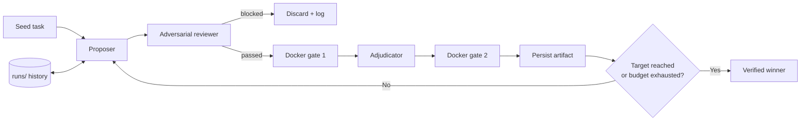

# The adversarial search loop

Minimal Harness extends the Meta-Harness paper's *propose → evaluate → log →
repeat* structure with an adversarial reviewer, an adjudicator, and two
independent Docker gates. Every candidate must survive all four checks before
it can win.

## Stages



| Stage | Role | Prompt file | Failure mode |
|---|---|---|---|
| Proposer | Emit a JSON array of candidate proposals given the seed and prior artifacts. | `meta_harness/prompts/proposer.md` | Malformed output is wrapped as a single raw-text proposal. |
| Reviewer | Inspect the candidate and emit executable `unittest` sources that Gate 1 runs. | `meta_harness/prompts/reviewer.md` | Invalid review blocks the candidate; failing reviewer tests fail Gate 1. |
| Gate 1 | Score the manifest and run reviewer tests under the same constraints. | Docker gate abstraction plus `task_evaluator.score_review_tests` | Non-zero exit, timeout, or a failing reviewer test is scored `0.0`. |
| Adjudicator | Rank non-dominated survivors by score and elapsed time. | `meta_harness/prompts/adjudicator.md` | Invalid selection falls back to the best score. |
| Gate 2 | Independent check: unseen split, differential against the incumbent, and repeated runs. | Docker gate abstraction plus manifest reruns | Flaky or dominated candidates are rejected. |
| Log | Persist source, review, gate result, and the adjudication outcome for each candidate. | `runs/iteration-N/candidate-ID/candidate.json` | — |

## Why two gates

The paper describes one evaluator outside the proposer. This project runs two
different mechanisms:

1. **Gate 1** scores the search manifest and executes the reviewer's
   generated tests. It is a strong, cheap filter over every candidate.
2. **Gate 2** is independent: it scores an unseen validation split, compares
   the candidate against the incumbent winner on the same split, and repeats
   the run to detect flakiness.

Gate 1 and Gate 2 results are stored separately in `gate1` and `gate2`, and a
`disagreement` flag is set when their outcomes differ. A `gate_disagreement`
event is emitted for the live dashboard. Divergence indicates either
nondeterminism or an overfit candidate, which is exactly what the second gate
exists to catch.

## Test-time verification

The same reviewer machinery runs in answer mode when
`HARNESS_ANSWER_TESTS=1`: the reviewer receives the task, the draft answer,
and a snapshot of the workspace, then writes executable unittest modules.
The harness runs them in the workspace. On failure, the failure output is
fed back as a system message and the agent gets one repair turn. This is the
test-time counterpart of the offline reviewer stage.

## Pareto selection and the incumbent ratchet

The adjudicator receives only the non-dominated survivors: candidate A
dominates B when A scores at least as well and runs no slower, with a strict
improvement in at least one dimension. Survivors that are faster but weaker
remain eligible, so the search can trade quality for cost.

A new winner replaces the incumbent only when it is strictly better or costs
less at the same score. This ratchet means the running winner cannot regress
across iterations.

## Held-out policy

The proposer, reviewer, adjudicator, and any search-time summary must never
receive held-out task results. Held-out evaluation runs after search, in a
separate process, against artifacts written to `runs/`.

## Stopping rule

Search stops when either:

- a candidate reaches the configured `target_score` after Gate 2, **or**
- the configured iteration budget is exhausted, **or**
- the user cancels from the live dashboard (`q`), which is reported as
  `cancelled by user` and checked between iterations.

Every completed iteration writes its full artifact set to `runs/` regardless
of outcome, so a killed run can be inspected and (in future) resumed.

## Artifact layout

Current on-disk layout:

```
runs/
  iteration-1/
    trajectory.jsonl        # one JSON line per model call in the iteration
    candidate-1/
      candidate.json        # id, source, proposal, review, dynamic_test, score
    candidate-2/
      candidate.json
  iteration-2/
    ...
```

`candidate.json` holds the candidate id and source, the proposal string,
the reviewer's structured verdict (including its generated tests), the
merged `dynamic_test` view, the independent `gate1` and `gate2` results, and
the final score (may be `null` when Docker is disabled). Gate 2 records
`consistent`, `runs`, `scores`, `incumbent_score`, `delta`, `beats_incumbent`,
`elapsed`, and `disagreement` when the corresponding inputs exist.

`trajectory.jsonl` records every model call the iteration made. Each line
carries a UTC timestamp, iteration number, stage (`proposer` / `reviewer` /
`adjudicator`), optional `candidate_id` (present for reviewer calls),
system prompt, user payload, and the raw model response. The file is
append-only within a run.

## Failure modes and defenses

| Failure | Defense |
|---|---|
| Model returns prose instead of JSON | `_json_value` recovers from fenced blocks; falls back to raw-text proposal. |
| Reviewer returns malformed JSON | Candidate is treated as blocked (`passed=False`). |
| Adjudicator returns an invalid selection | Deterministic fallback selects the first Gate 1 survivor. |
| Docker command hangs | Container timeout returns `0.0` and the candidate is discarded. |
| Gate 1 and Gate 2 disagree | Both results are stored separately; `disagreement` and a `gate_disagreement` event record it. |
| Reviewer tests are prompt-injected or nondeterministic | They run as ordinary `unittest` sources in the same scratch directory as the solution; a failure blocks Gate 1. |
